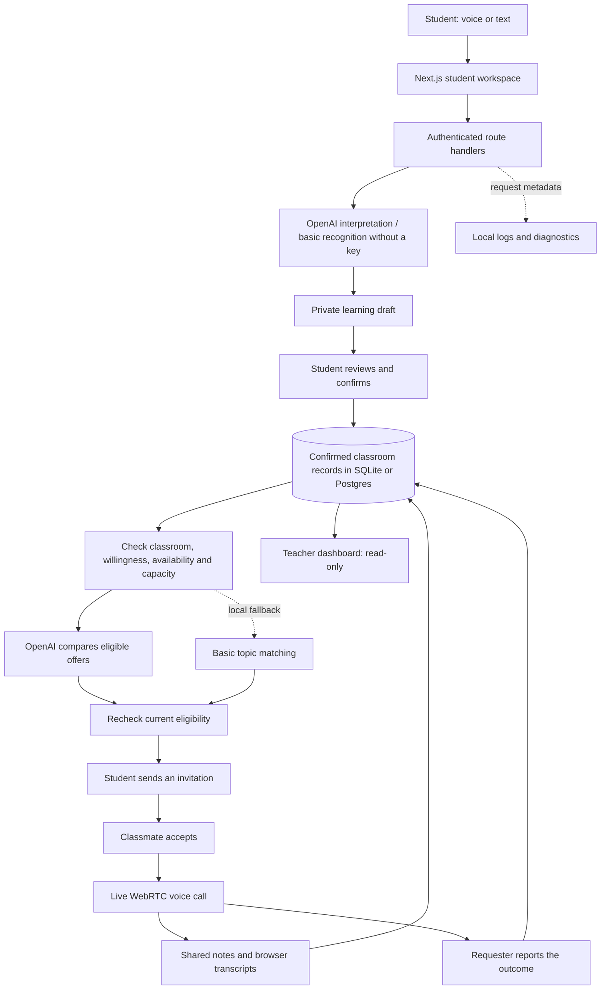

<div align="center">

# FavourLoop

### Say what you need. Find your learning circle.

<p>
  
  
  
  
  
  
</p>

**FavourLoop** helps high-school students ask for help through voice and connect with classmates who have offered to help. OpenAI turns their words into private drafts and suggests suitable peers after confirmation. Students choose whether to connect, learn together in live voice calls, and share their progress with teachers through a read-only classroom view.

**Speak. Review. Connect. Learn together.**

[Architecture](#system-architecture) · [Workflow](#the-workflow-pipeline) · [Features](#features) · [Test Results](#recorded-test-results) · [Quick Start](#quick-start) · [API](#api-reference) · [Logging Guide](docs/LOGGING.md)

</div>

---

## What Makes This Different

A classroom already contains people who can help one another. FavourLoop gives students a simple way to describe what they need, volunteer what they can explain, and find a willing classmate.

| Student or teacher question                               | FavourLoop's approach                                                                                                           |
| --------------------------------------------------------- | ------------------------------------------------------------------------------------------------------------------------------- |
| Can I ask without typing?                                 | Browser speech recognition captures the request, followed by an editable draft for review.                                      |
| Can I ask for help if I have nothing to offer yet?        | Helping is optional. A student does not need to repay a favor or earn credits before asking.                                    |
| What if two students describe the same topic differently? | OpenAI compares the meaning and stated scope of confirmed requests and eligible offers.                                         |
| Who decides whether a connection happens?                 | One student sends an invitation, and the classmate chooses whether to accept it.                                                |
| What can a teacher see?                                   | Confirmed classroom activity, sessions, shared notes, available transcripts, and reports. Private drafts stay with their owner. |
| What happens if someone becomes unavailable?              | The server checks eligibility again before showing suggestions and creating an invitation.                                      |
| Why bring classmates into the loop?                       | AI handles interpretation and coordination; students explain, ask follow-up questions, and work through the problem together.   |

> **Prototype scope:** a local classroom demo with fictional accounts and public demo invitation codes. School enrollment, retention rules, and reliable media infrastructure need further work before a real school pilot.

## System Architecture



The model suggests interpretations and matches. Server code enforces access, classroom boundaries, availability, and session state. A recommendation never sends an invitation or accepts a call on a student's behalf. Matching runs after confirmation and when a student asks to find a helper.

## The Workflow Pipeline

### 1. Join your classroom

Students and teachers have separate signup paths and role-specific classroom invitations. Students manage their own requests and offers. Teachers observe the published activity in their classroom.

### 2. Say it and review it

Describe a current learning need and, optionally, something you can help with:

> I need help factoring quadratic equations. I can help with balancing chemical equations.

OpenAI proposes separate request and offer cards. The student reviews and edits them before confirming. Typing is available when speech recognition is unavailable or inconvenient. A draft is private until confirmation.

### 3. Find a willing classmate

The app filters eligible offers from the same classroom, then asks OpenAI to compare up to 12 offers with the confirmed request. It returns at most three suggestions with short explanations. The original offer stays visible for the student to review.

If AI matching is unavailable or disabled, the app uses clearly labeled local topic matching. A helper does not need to be seeking help themselves, and the requester does not need to offer anything in return.

### 4. Agree and talk

The requester sends an invitation. The classmate can accept or decline. Once accepted, both participants can acknowledge the teacher-visibility notice and join an in-app voice call.

Students can mute their microphones, share written notes, and leave or end the session. Browser-generated transcripts are best-effort and show an unavailable or interrupted state when the speech service fails. Teachers can view shared material but cannot join the call.

### 5. Record what happened

The requester reports whether the conversation helped or whether they still need help. Ending a call alone does not mark the question resolved. Confirmed activity and outcomes appear in the teacher's classroom view; students can also report a session for review.

## Features

### Voice input with student confirmation

- Browser speech recognition captures learning needs and voluntary offers, with editable text and read-aloud support.
- OpenAI Responses API produces structured draft cards for review.
- Private drafts expire after 30 minutes and are saved to the learning profile only after confirmation.
- The profile records current self-reported needs and offers, rather than assigning permanent ability labels.
- Without an API key, a limited, explicitly labeled topic recognizer remains available.

### AI matching with server checks

- Semantic matching can connect equivalent wording that a keyword matcher misses.
- Candidates must be available students with an active offer in the same classroom and subject.
- Self-matches, declined invitations, and occupied participants are filtered out.
- The server validates returned offer IDs and checks current eligibility again after the model responds and before an invitation is sent.
- AI recommendations expire after 15 minutes. A valid empty result stays empty; provider failures use the local fallback.

### Live peer learning

- Real peer-to-peer WebRTC audio with server-authorized signaling and a public STUN server.
- Both students choose whether to connect; neither AI nor a teacher can accept for them.
- Shared written notes work independently of browser transcription.
- The app does not archive call audio. Each browser publishes its own transcript under the authenticated participant's account when speech recognition is available.
- Requester-reported outcomes keep an ended call separate from a resolved question.

### Teacher visibility and classroom boundaries

- A read-only dashboard shows students, confirmed requests, offers, sessions, activity, and reports.
- Teachers cannot edit student learning records or access call signaling.
- Access checks run on the server, including role, classroom, ownership, and current state.
- Passwords use salted scrypt hashes; login sessions use hashed tokens in HTTP-only, SameSite=Strict cookies.
- Students can withdraw offers, close open requests, and pause their availability.

### Evidence and diagnostics

- Logged commands retain their output, timestamps, and exit status in separate run directories.
- Playwright retains browser traces and screenshots for passing and failing tests.
- API responses expose a trace ID that connects HTTP activity with AI request metadata.
- Model diagnostics record provider request IDs, timing, token usage, candidate counts, and fallback reasons.
- Runtime logging omits credentials, raw learning statements, call audio, and transcripts. Browser test artifacts contain explicitly synthetic classroom data.

## Recorded Test Results

The recorded **November 7, 2026** validation used isolated local databases and synthetic student accounts.

| Recorded result                 | Outcome                                                                            |
| ------------------------------- | ---------------------------------------------------------------------------------- |
| Unit tests                      | **23 passed**                                                                      |
| Browser tests                   | **4 passed**, with a trace for each                                                |
| TypeScript and production build | Passed                                                                             |
| Live OpenAI integration         | Passed: interpretation, semantic matching, scope exclusions, and invitation checks |
| Live voice connection           | Real WebRTC connection verified using synthetic audio                              |
| Logged credential check         | No configured API key found in the recorded artifact scan                          |

| Checked example                                             | Verified behavior                                                 |
| ----------------------------------------------------------- | ----------------------------------------------------------------- |
| A student creates an unconfirmed draft                      | The teacher cannot see it.                                        |
| A request describes a second-degree expression as a product | AI matches it to Maya's factoring offer despite no keyword match. |
| An offer explicitly excludes factoring                      | That offer is not recommended for the factoring request.          |
| A recommendation has expired                                | The invitation is rejected.                                       |
| A suggested helper pauses availability                      | The invitation is rejected after the fresh availability check.    |
| A teacher tries to join a call or mutate a student record   | The server rejects the action.                                    |
| A student requests another classroom's data                 | Classroom isolation is enforced.                                  |
| The requester and helper agree to connect                   | A session is created only after acceptance.                       |

**Coverage scope:** these are recorded checks of specific synthetic scenarios, not a whole-app coverage percentage or a live CI status. They do not establish real-microphone quality, speech-recognition accuracy, or school-scale performance. See the [verification report and screenshots](docs/VERIFICATION.md) and [logging guide](docs/LOGGING.md). The detailed run index stays in the ignored local `.logs/` directory. Run the commands below to check the current application.

## Tech Stack

| Layer                | Technology                                       | Responsibility                                                         |
| -------------------- | ------------------------------------------------ | ---------------------------------------------------------------------- |
| Frontend             | Next.js 16, React 19, TypeScript 5.9             | Signup, student workspace, teacher dashboard, and call room            |
| Backend              | Next.js route handlers, Node.js 24               | Authentication, classroom access, matching, invitations, and signaling |
| AI                   | OpenAI Responses API with structured output      | Draft learning records and compare eligible offers                     |
| Validation           | Zod 4                                            | Validate request bodies and model output                               |
| Persistence          | SQLite locally; Neon Postgres on Vercel          | Users, classrooms, drafts, learning records, invitations, and sessions |
| Voice input          | Browser SpeechRecognition and speech synthesis   | Speech-to-text capture and read-aloud support                          |
| Live audio           | WebRTC with STUN                                 | Peer-to-peer student calls                                             |
| Browser verification | Playwright with Google Chrome                    | Workflow, role boundaries, mobile layout, and voice-connection checks  |
| Developer checks     | Node test runner, TypeScript, Next.js build      | Unit tests, type checking, and production compilation                  |
| Diagnostics          | Local JSON records, command logs, browser traces | Request correlation and retained development evidence                  |

## Project Structure

```text
FavourLoop/
├── app/
│   ├── api/[...path]/route.ts   # Authentication and classroom API
│   ├── dashboard/              # Student and teacher workspace
│   ├── signup/[role]/          # Separate student and teacher signup
│   ├── session/[id]/           # Live peer-learning session
│   └── globals.css             # Application styling
├── components/
│   ├── landing.tsx             # Introduction and demo entry points
│   ├── auth.tsx                # Registration and login
│   ├── dashboard.tsx           # Student workflow and teacher observation
│   ├── voice-panel.tsx         # Speech capture and draft review
│   └── session-room.tsx        # Voice call, notes, and outcomes
├── lib/
│   ├── db.ts                   # Async local/hosted database adapter
│   ├── interpret.ts            # AI interpretation and basic recognition
│   ├── matching.ts             # Eligibility and local topic matching
│   ├── recommend.ts            # Bounded OpenAI recommendations
│   ├── match-service.ts        # Rechecks and recommendation expiry
│   ├── diagnostics.ts          # Metadata-only request logging
│   └── types.ts                # Shared application types
├── scripts/
│   ├── run-logged.mjs          # Preserve command output and run status
│   ├── prepare-local.mjs       # Prepare local build caches when needed
│   └── check-ai-matching.mjs   # Live integration check with synthetic data
├── tests/
│   ├── *.test.ts               # Interpretation, matching, and service tests
│   └── browser/app.spec.ts     # Browser workflows and voice connection
├── docs/
│   ├── PRODUCT.md              # Product scope and future work
│   ├── AI-MATCHING-PROPOSAL.md  # Approved AI matching data flow
│   ├── VERIFICATION.md         # Recorded results and screenshots
│   └── LOGGING.md              # Trace and diagnostics guide
├── .data/                      # Ignored local SQLite databases
├── .logs/                      # Ignored logs, reports, and traces
└── .env.example                # Configuration template; no credentials
```

Application source stays in this project. Private configuration, dependencies, generated output, local databases, and runtime logs are excluded from Git.

## Quick Start

### Run the classroom app

Use **Node.js 24 LTS** and npm. The deployment and local runtime use Node.js 24, including built-in SQLite for local development. Browser verification uses an installed copy of Google Chrome.

From the FavourLoop project folder:

```bash
npm install
cp -n .env.example .env.local
node scripts/run-logged.mjs dev npm run dev
```

`cp -n` preserves an existing `.env.local`. Set `OPENAI_API_KEY` in that local file to enable AI interpretation and matching; the model defaults to `gpt-4.1-mini`. Restart the server after changing configuration. Credentials stay on the server and must not be committed.

Open **http://127.0.0.1:3000**. Without a key, basic topic recognition and local matching remain available. The app binds to loopback by default and persists classroom data in `.data/favourloop.sqlite`.

### Try the demo

Open **Alex · student**, **Maya · student**, and **Ms. Rivera · teacher** in separate browser profiles or contexts. Ordinary tabs share login cookies.

Sam and Jordan also have demo sign-in buttons on the homepage. Seeded demo accounts use these buttons, not email/password credentials; accounts created through signup use the password you chose.

Alex asks about quadratic equations; Maya has volunteered to help. Find Maya, send an invitation, accept it from Maya's account, and open the session in both student accounts. Acknowledge the teacher-visibility notice before joining. Headphones help prevent feedback when testing two microphones. The teacher can observe published activity and shared notes or available transcripts.

New accounts can also use the [demo classroom invitations](#demo-classroom-invitations) below.

### Validate the code

```bash
node scripts/run-logged.mjs unit npm test
node scripts/run-logged.mjs build npm run build
```

For a local production preview after building:

```bash
ALLOW_DEMO=true node scripts/run-logged.mjs preview npm start
```

### Run browser checks

Use a separate test database. The empty API-key override keeps the regular browser suite deterministic and avoids paid API calls.

```bash
# Terminal 1
OPENAI_API_KEY= FAVOURLOOP_DB="$PWD/.data/test.sqlite" FAVOURLOOP_BUILD_DIR=.next-test node scripts/run-logged.mjs test-server npm run dev -- --port 3001

# Terminal 2
TEST_URL=http://127.0.0.1:3001 node scripts/run-logged.mjs browser npm run test:e2e
```

Logged browser runs retain their report, screenshots, and traces in `.logs/browser/<run-id>/`. Plain `npm run test:e2e` uses `playwright-report/` and `test-results/`.

### Check the live OpenAI integration

Build the app first, then use the dedicated synthetic-data database and the key in `.env.local`:

```bash
# Terminal 1
ALLOW_DEMO=true FAVOURLOOP_DB="$PWD/.data/ai-matching-check.sqlite" node scripts/run-logged.mjs ai-server npm start -- --port 3002

# Terminal 2
TEST_URL=http://127.0.0.1:3002 node scripts/run-logged.mjs ai-matching node scripts/check-ai-matching.mjs
```

This optional check sends a hard-coded synthetic learning statement and approved fields from fictional offers to OpenAI. Results, a screenshot, and a browser trace are retained in `.logs/integration/<run-id>/`.

### Configuration

| Variable                        | Purpose                                                                  |
| ------------------------------- | ------------------------------------------------------------------------ |
| `OPENAI_API_KEY`                | Enable AI interpretation and, by default, AI matching.                   |
| `OPENAI_MODEL`                  | Select the model; defaults to `gpt-4.1-mini`.                            |
| `OPENAI_MATCHING_ENABLED=false` | Keep matching local while retaining AI interpretation.                   |
| `ALLOW_DEMO=true`               | Enable fictional demo accounts, including a local production preview.    |
| `FAVOURLOOP_DB`                 | Select a separate SQLite database for testing or local operation.        |
| `COOKIE_SECURE=true`            | Use secure authentication cookies when serving over HTTPS.               |
| `FAVOURLOOP_ORIGIN`             | Set the canonical public origin when using an HTTPS reverse proxy.       |
| `FAVOURLOOP_LOG_DIR`            | Change the runtime diagnostic destination; defaults to `.logs/runtime/`. |

<details>
<summary><strong>Local setup on this Mac: Documents and iCloud</strong></summary>

The project lives in `~/Documents/FavourLoop`. On this machine, `node_modules` links to `~/Library/Caches/FavourLoop/dependencies/node_modules`, and generated `.next` output uses a local cache prepared by the npm commands. This avoids loading cloud-only placeholders as executable files while keeping application source in Documents.

Set `FAVOURLOOP_LOCAL_CACHE=false` to disable automatic build-cache preparation. A fresh copy on another machine can use an ordinary `npm install`.

If Documents is synced with iCloud, choose **Keep Downloaded** for the FavourLoop folder so source files and local data remain available. See [Apple's instructions](https://support.apple.com/guide/mac-help/mchl1a02d711/mac).

</details>

### Vercel hosting

Live demo: [favourloop.vercel.app](https://favourloop.vercel.app).

See [Deployment](docs/DEPLOYMENT.md) for the hosted database, configuration, and verification. Set `DATABASE_URL` to use Postgres; leave it unset for local SQLite.

## API Reference

Classroom endpoints require authentication and enforce roles, ownership, and classroom boundaries. Teachers have read-only access to learning interactions. Demo login is available only when enabled.

| Endpoint                            | Purpose                                                        |
| ----------------------------------- | -------------------------------------------------------------- |
| `GET /api/config`                   | Read demo and AI feature availability.                         |
| `POST /api/auth/signup`             | Register with a role-specific classroom invitation.            |
| `POST /api/auth/login`              | Sign in with email and password.                               |
| `POST /api/auth/logout`             | End the current login session.                                 |
| `POST /api/auth/demo`               | Enter an enabled fictional demo account.                       |
| `GET /api/state`                    | Read the authenticated user's classroom view.                  |
| `POST /api/intake`                  | Interpret a statement into a private draft.                    |
| `POST /api/intake/confirm`          | Confirm reviewed request and offer cards.                      |
| `GET /api/matches/:needId`          | Find eligible helpers for the student's own request.           |
| `POST /api/invite`                  | Invite an eligible helper for an owned request.                |
| `POST /api/proposals/respond`       | Accept or decline a received invitation.                       |
| `POST /api/availability`            | Change the student's availability.                             |
| `POST /api/offers/withdraw`         | Withdraw an owned offer.                                       |
| `POST /api/needs/cancel`            | Close an owned open request.                                   |
| `GET /api/sessions/:id`             | Read an authorized session and its shared transcript or notes. |
| `POST /api/sessions/:id/join`       | Acknowledge the call notice as a participant.                  |
| `GET /api/sessions/:id/signals`     | Poll signaling messages as a participant.                      |
| `POST /api/sessions/:id/signal`     | Exchange authorized WebRTC signaling.                          |
| `POST /api/sessions/:id/transcript` | Publish a participant's speech transcript or written note.     |
| `POST /api/sessions/:id/end`        | End the conversation without declaring an outcome.             |
| `POST /api/sessions/:id/outcome`    | Record the requester's learning outcome.                       |
| `POST /api/sessions/:id/report`     | Ask the classroom teacher to review a session.                 |

API responses carry `X-FavourLoop-Trace-Id`. Use it to find the corresponding HTTP and model events in the local diagnostics file. See the [logging guide](docs/LOGGING.md).

## Key Engineering Decisions

**1. A student's confirmation creates the learning record.**
AI output stays in a private, expiring draft until the student reviews it. The system stores stated needs and voluntary offers without inferring grades, diagnoses, or permanent weaknesses.

**2. AI compares meaning; server code controls access and eligibility.**
The model sees only the confirmed request's subject, topic, and detail, plus up to 12 eligible offer IDs and their subject, topic, and detail. Account names, emails, full profiles, and call content are not separate payload fields. Free text can still contain personal information. See the [AI data flow](docs/AI-MATCHING-PROPOSAL.md).

**3. A recommendation is temporary and does not create consent.**
Eligibility is rechecked after the model returns and when an invitation is sent. The helper must accept. A student can ask for help without volunteering an offer or owing a favor in return.

**4. Teacher access is enforced on the server.**
The teacher dashboard reads confirmed activity and shared session material. It cannot edit student records, join a call, or access the signaling channel.

**5. Learning outcomes come from the requester.**
A closed call is not proof of understanding. The requester reports whether it helped; recorded outcomes cannot be changed later to overwrite a newer request state.

**6. Diagnostics retain useful evidence without logging learning conversations.**
Runtime events contain metadata rather than raw student statements or model response bodies. `store: false` is used for OpenAI requests, but it is not a promise of zero provider retention. Browser traces are collected from isolated synthetic test accounts, and all development artifacts remain local.

## Domain Reference

### Demo accounts

| Account      | Role    | Starting point                                                 |
| ------------ | ------- | -------------------------------------------------------------- |
| Alex Morgan  | Student | Needs help with quadratic equations and offers chemistry help. |
| Maya Chen    | Student | Offers help with factoring and the quadratic formula.          |
| Jordan Ellis | Student | Needs chemistry help and offers essay-structure help.          |
| Sam Taylor   | Student | Offers help with cell division.                                |
| Ms. Rivera   | Teacher | Observes Class 10B's confirmed activity and sessions.          |

### Demo classroom invitations

| Classroom | Student code | Teacher code |
| --------- | ------------ | ------------ |
| Class 10B | `LOOP10`     | `TEACH10`    |
| Class 11A | `LOOP11`     | `TEACH11`    |

These are public invitations for fictional classroom demonstrations, not production enrollment credentials. Class 11A provides a separate classroom for isolation checks. Demo access is disabled by default in production unless explicitly enabled.

### Learning records

| Record   | Meaning                                                                         |
| -------- | ------------------------------------------------------------------------------- |
| Need     | A confirmed learning question: open, matched, resolved, or cancelled.           |
| Offer    | A voluntary topic the student is comfortable helping with; it can be withdrawn. |
| Proposal | An invitation that may be pending, accepted, declined, or expired.              |
| Session  | An accepted conversation that is ready, active, or ended.                       |
| Outcome  | The requester's report that the question was resolved or still needs help.      |

## Current Limits

- This is a classroom demo with local SQLite and hosted Postgres support. Email verification, account recovery, roster administration, school SSO, production invitation rotation, moderation services, and retention/deletion policies remain future work.
- Browser speech recognition depends on microphone permission, browser support, network access, and the speech service. It may process audio externally. Real-voice accuracy and speaker identity have not been verified; text entry and written notes remain available.
- Reliable calls across restricted networks need TURN infrastructure, and microphone access outside localhost needs HTTPS. The current peer-to-peer call shutdown relies on cooperating clients; centrally enforced media revocation needs managed infrastructure.
- AI matching considers at most 12 eligible offers per lookup and provides suggestions for students to review. It does not measure ability or guarantee a useful session.
- Matching is request-driven. Background outreach, scheduled reminders, detailed availability windows, and an autonomous notification workflow are not implemented.
- Updating a learning need or offer currently means closing or withdrawing it and confirming a corrected draft. Logs remain on disk until removed manually.

## Builder

| Builder                                       | Ownership                                                                                         |
| --------------------------------------------- | ------------------------------------------------------------------------------------------------- |
| [Bhuvan Gowda](https://github.com/bhuvan1201) | Solo builder — product direction, student and teacher experience, AI integration, and local demo. |

Built for students to ask, offer, and learn together.

<div align="center">

<sub>Next.js · React · TypeScript · OpenAI · SQLite · WebRTC · Playwright</sub>

</div>
